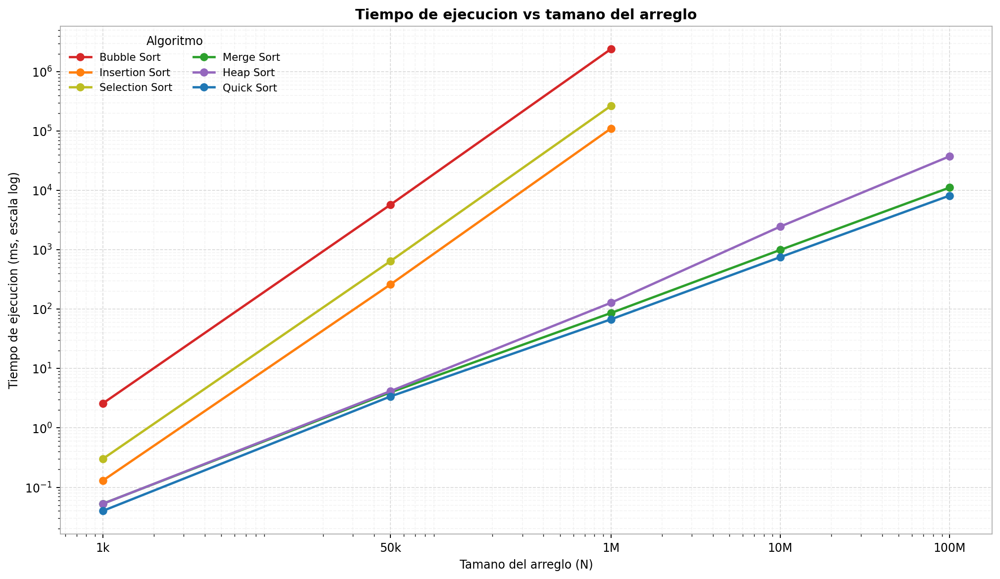
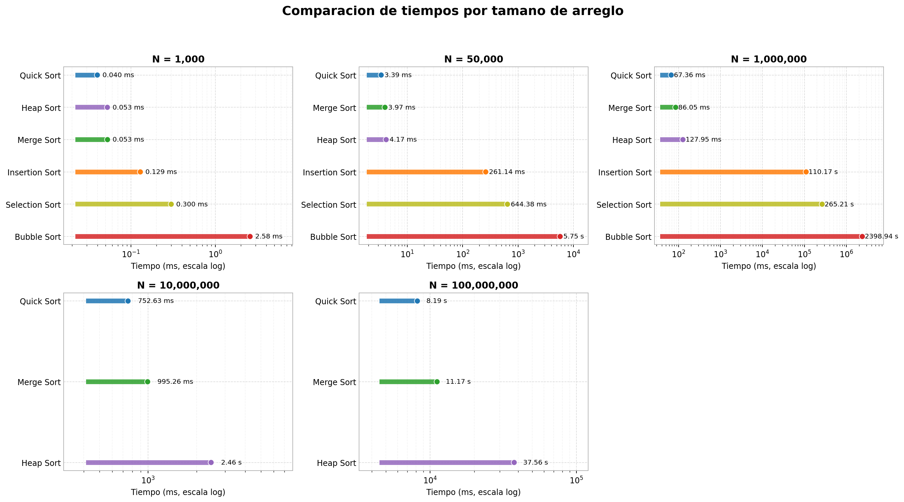
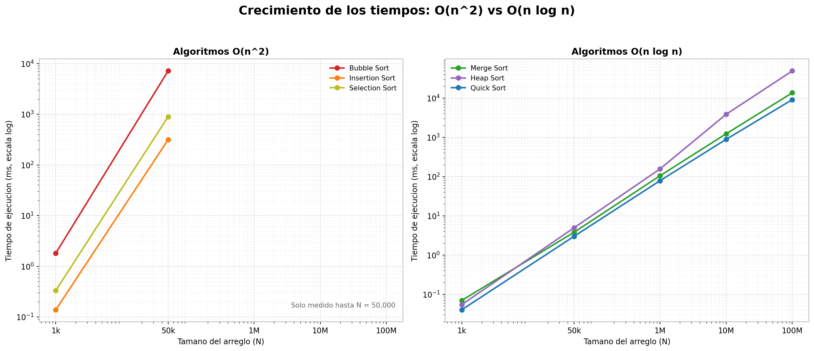

# Resultados

Graficas generadas por `scripts/graficar.py` a partir de `data/resultados.csv`.

## Tiempo vs tamano del arreglo

## Comparacion por tamano de arreglo

## Crecimiento O(n^2) vs O(n log n)

